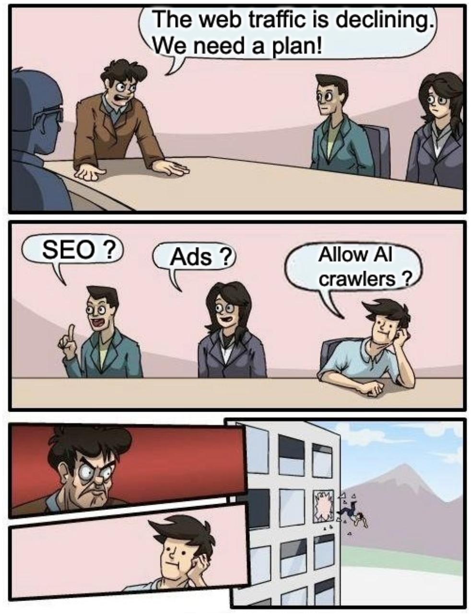

# The Great GPT Firewall 📛

This collection is a curated list of websites that employ the `robots.txt` file to restrict access to AI Agents, AI crawlers and GPTs.

It will be updated monthly.



## User agents & robots.txt

The `robots.txt` file allows website owners to control and limit the access of these user agents to certain areas of their website by specifying rules and directives.

```txt
# OpenAI’s web crawler: GPT3.5, GPT4, ChatGPT
# https://platform.openai.com/docs/bots
User-agent: GPTBot

# ChatGPT plugins
# https://platform.openai.com/docs/bots
User-agent: ChatGPT-User

# OpenAI Search bot
# https://platform.openai.com/docs/bots
User-agent: OAI-SearchBot

# Google's web crawler: Bard, VertexAI, Gemini
# https://blog.google/technology/ai/an-update-on-web-publisher-controls/
User-agent: Google-Extended

# Apple's web crawler, dedicated to GenAI projects
# https://support.apple.com/en-us/119829
User-agent: Applebot-Extended

# Claude
User-agent: anthropic-ai

# Claude Bot
User-agent: ClaudeBot

# Claude web
User-agent: Claude-Web

# Amazonbot
# https://developer.amazon.com/amazonbot
User-agent: Amazonbot

# Cohere
User-agent: Cohere-ai
User-agent: cohere-training-data-crawler

# Perplexity
User-agent: PerplexityBot

# You
# https://about.you.com/fr/youbot/
User-agent: YouBot

# Common Crawl
# https://commoncrawl.org/ccbot
User-agent: CCBot

# Omglibot: webz.io
# https://webz.io/blog/web-data/what-is-the-omgili-bot-and-why-is-it-crawling-your-website/
User-agent: Omgilibot
User-agent: Omgili
User-agent: Webzio-Extended

# Facebook: Llama
# https://developers.facebook.com/docs/sharing/bot/
User-agent: FacebookBot

# Facebook
# https://developers.facebook.com/docs/sharing/webmasters/web-crawlers/
User-agent: Meta-ExternalAgent

# ByteDance: Duobao
User-agent: Bytespider

# Ai2
# https://allenai.org/crawler
User-agent: Ai2bot
User-agent: Ai2Bot-Dolma

# Diffbot
User-agent: Diffbot

# Huawei
# https://darkvisitors.com/agents/pangubot
User-agent: PanguBot

# Petal Search
# https://datadome.co/learning-center/how-to-block-petal-bot/
User-agent: PetalBot

Timpibot
# https://darkvisitors.com/agents/timpibot
User-agent: Timpibot

# Firecrawl
# https://darkvisitors.com/agents/firecrawlagent
User-agent: FirecrawlAgent

# Exa
# https://exa.ai/docs/reference/exa-crawler
User-agent: ExaBot

# Claude search and user-initiated fetch
# https://support.claude.com/en/articles/8896518-does-anthropic-crawl-data-from-the-web-and-how-can-site-owners-block-the-crawler
User-agent: Claude-SearchBot
User-agent: Claude-User

# Perplexity user-initiated fetch
# https://docs.perplexity.ai/guides/bots
User-agent: Perplexity-User

# DuckDuckGo AI answers
# https://duckduckgo.com/duckduckgo-help-pages/results/duckassistbot
User-agent: DuckAssistBot

# Google Vertex AI
# https://developers.google.com/search/docs/crawling-indexing/google-special-case-crawlers
User-agent: Google-CloudVertexBot

# Manus
# https://darkvisitors.com/agents/manus-user
User-agent: Manus-User

# Censorship area
Disallow: /
```

## Disclaimer

Please note that this blocklist is intended for informational purposes only. Despite the provoking project name, it's fine to disallow web crawling and protect content ownership. 

## <YYYY-MM> update

<RESULT>

## 🤝 Contributing

Looking for contributions:
- Enrich website database
- Chinese websites
- New categories

Please open issues!

- Ping me on Twitter [@samuelberthe](https://twitter.com/samuelberthe) (DMs, mentions, whatever :))
- Fork the [project](https://github.com/samber/the-great-gpt-firewall)
- Fix [open issues](https://github.com/samber/the-great-gpt-firewall/issues) or request new features

Don't hesitate ;)

### Build

```bash
python -m venv venv
source ./venv/bin/activate
pip3 install -r requirements.txt
python3 scrape.py
# then copy the last version into readme
```

## 👤 Contributors


## 💫 Show your support

Give a ⭐️ if this project helped you!

[](https://github.com/sponsors/samber)

## 📝 License

Copyright © 2024 [Samuel Berthe](https://github.com/samber).

This project is [MIT](./LICENSE) licensed.
